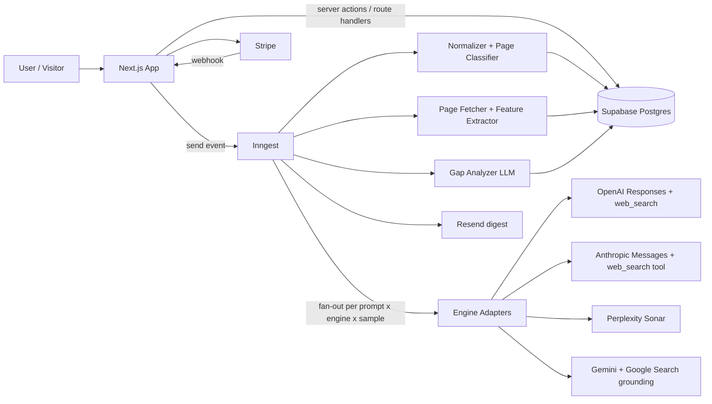

# 01 — TRD: Technical Requirements Document

> **How to use this file:** Paste into a coding agent as the implementation spec. Follow decisions literally; if something is ambiguous, pick the simplest option that satisfies the PRD (`06-PRD.md`) and note the assumption in `/docs/decisions.md`. Provider API field names below MUST be verified against current official docs before coding; wrap all provider parsing in the adapter layer so changes are one-file fixes.

## 1. Stack (decided)
| Concern | Choice | Why | Rejected |
|---|---|---|---|
| Framework | **Next.js 15 (App Router) + TypeScript** | One deployable for UI + API routes; team knows it | Separate FastAPI (extra deploy surface for a hackathon) |
| UI | Tailwind v4 + shadcn/ui + Recharts | Fast, consistent | Custom CSS system |
| DB/Auth | **Supabase Postgres + Supabase Auth** | Auth + RLS + SQL in one | Firebase (weak relational reporting) |
| ORM | Drizzle | Typed, thin, SQL-first | Prisma (heavier, slower cold start) |
| Jobs/cron | **Inngest** | Cron, fan-out, retries, concurrency limits, free tier | BullMQ+Redis (infra), Vercel cron alone (no retries/fan-out) |
| LLM analysis | Anthropic or OpenAI via a thin `llm()` wrapper, JSON-schema output | Swappable | Framework-heavy agent libs |
| Page fetch | `undici` + `linkedom` + `@mozilla/readability` | No headless browser needed for MVP | Playwright (slow, costly) — P2 fallback for JS-rendered pages |
| Email | Resend | Simple | SES |
| Payments | Stripe Checkout + webhooks | Standard | Paddle/LemonSqueezy (acceptable later) |
| Hosting | Vercel (app) + Supabase + Inngest Cloud | Zero-ops | Self-host |
| Errors | Sentry | — | — |

## 2. Architecture


## 3. Repo layout
```
/src
  /app                      # routes (see 02-App-Flow)
  /server
    /engines                # one file per provider + index.ts registry
      types.ts openai.ts anthropic.ts perplexity.ts gemini.ts
    /pipeline
      normalize-url.ts classify-page.ts discover-pages.ts
      extract-features.ts analyze-gap.ts build-fix-report.ts
    /jobs                   # inngest functions
      run-check.ts run-prompt-engine.ts sample-report.ts weekly-digest.ts verify-fixes.ts
    /db                     # drizzle schema, queries
    /billing /email /security
  /lib                      # shared utils, zod schemas
/tests                      # unit + fixtures (recorded provider JSON)
/docs decisions.md
```

## 4. Engine adapter contract (the most important interface)
```ts
export type EngineId = 'chatgpt' | 'claude' | 'perplexity' | 'gemini';

export interface EngineCitation {
  url: string;              // raw URL as returned (resolve redirects for gemini)
  title?: string;
  position: number;         // 1-based order of first appearance in answer
  kind: 'cited' | 'retrieved'; // cited = referenced in answer; retrieved = search result seen but not cited
  citedText?: string;       // snippet the engine attributed, if provided
}

export interface EngineResult {
  engine: EngineId;
  model: string;            // exact model string used
  answerText: string;
  citations: EngineCitation[];
  searchQueries: string[];  // queries the engine issued, if exposed
  raw: unknown;             // full provider JSON, stored for replay
  latencyMs: number;
  costUsd: number;          // estimated from usage + tool-call pricing table
}

export interface EngineAdapter {
  id: EngineId;
  run(prompt: string, opts: { country?: string; timeoutMs?: number }): Promise<EngineResult>;
}
```
Rules: adapters MUST NOT throw on "no citations" (return empty); MUST throw typed errors `RateLimited | Timeout | ProviderDown | BadResponse`; MUST persist `raw`.

### Provider parsing notes (verify against docs)
- **OpenAI (chatgpt):** Responses API with the `web_search` tool. Citations come as `url_citation` annotations on output text content (url, title, start/end index). Issued queries appear on `web_search_call` output items. Model string from env `OPENAI_MODEL`.
- **Anthropic (claude):** Messages API with the web search server tool and `max_uses` capped (e.g. 5). Text blocks carry citation objects (url, title, cited_text); `web_search_tool_result` blocks list **all retrieved results** → store those as `kind:'retrieved'`. Model from env `ANTHROPIC_MODEL`.
- **Perplexity:** Sonar chat-completions; response includes a `citations` URL array and `search_results` (title, url, date). Citation numbers `[n]` in the text map to array index n-1 → compute `position` from first appearance.
- **Gemini (P1):** `google_search` grounding; `groundingMetadata.groundingChunks[].web.uri` are redirect URLs → resolve with HEAD/GET (follow ≤3 redirects, 3 s timeout), cache resolution table.
- Same user prompt MUST be sent verbatim to every engine (no per-engine rewriting). A neutral system prompt MAY be used: "Answer concisely with sources." Store it in the run record.

## 5. URL normalization & page classification
`normalizeUrl(u)`: lowercase scheme+host; strip `www.`; drop fragment; drop `utm_*`, `ref`, `gclid`, `fbclid`, `source`; remove trailing slash (except root); sort remaining query params; decode redundant percent-encoding.
`classifyPage(url, title?)` → `pricing | docs | comparison | alternatives | blog | changelog | integrations | homepage | other`. First match wins:
1. host starts `docs.|developer.|developers.|help.|support.` OR path `^/(docs|documentation|guides?|api(-reference)?|reference|help|learn|tutorials?)(/|$)` → `docs`
2. path `/(pricing|plans?|price|packages)` → `pricing`
3. path `/(vs|versus|compare|comparison)(/|-)` OR `-vs-` anywhere in slug → `comparison`
4. path `/(alternatives?|competitors?)(/|-)` OR slug ends `-alternatives` → `alternatives`
5. `/blog|/resources|/articles` → `blog`; `/changelog|/release-notes` → `changelog`; `/integrations?|/apps|/marketplace` → `integrations`
6. root path → `homepage`; else `other`.
Unit-test with ≥40 URL fixtures. Ownership: `hostname === ownDomain` or endsWith(`.`+ownDomain) → `own`; matches a tracked competitor → `competitor`; else `third_party` (G2, Reddit, Wikipedia, blogs — **track these too**: they are often the winners).

## 6. Run orchestration (Inngest)
1. Event `check/run.requested {workspaceId, trigger}` → create `check_runs` row (budget pre-check).
2. Fan-out `run-prompt-engine` per `(prompt, engine, sampleIdx)`; step id = `${runId}:${promptId}:${engine}:${sampleIdx}` (idempotent).
3. Concurrency: global per provider (OpenAI 10, Anthropic 5, Perplexity 5, Gemini 5), per workspace 3. Retries: 3 with exponential backoff on `RateLimited|Timeout`; no retry on `BadResponse`.
4. After each result: normalize citations → insert `responses` + `citations`; upsert `pages` (unfetched stub).
5. When all steps settle: status `succeeded | partial | failed`; enqueue `build-fix-reports` for newly lost prompts (cap 5 per run unless plan allows more); enqueue `verify-fixes`.
6. Schedule: Inngest cron `0 * * * *` selects workspaces whose `next_run_at <= now()`; Starter weekly, Growth 2×/week.

## 7. Fix-report pipeline
For each lost `(prompt, engine)`:
1. **Winner set:** cited URLs that are competitor or third-party, top 3 by position.
2. **Own candidate:** among own pages (from `pages` / sitemap discovery) with the same `page_type` as the winner, choose highest cosine/keyword match to the prompt (simple: BM25-style overlap on title + h1 + text). None → finding `MISSING_PAGE` (critical).
3. **Fetch** winner + own (cache 24 h by `content_hash`). SSRF-safe fetcher (§8). Extract readable text (cap 12k tokens each).
4. **Deterministic features** (`extract-features.ts`) for both pages:
   - HTTP status, final URL, `noindex` (meta + header), canonical mismatch
   - robots.txt allow/deny for `GPTBot, OAI-SearchBot, ChatGPT-User, ClaudeBot, Claude-SearchBot, PerplexityBot, Google-Extended` (own domain only; this is a P0 finding if blocked)
   - Main content present in **raw HTML** (word count of readable text vs `<script>` weight) → flag `LIKELY_JS_RENDERED`
   - Price tokens in text (`$\d`, `/mo`, `per seat`), plan-name count, comparison/pricing `<table>` count
   - JSON-LD types (`Product, Offer, SoftwareApplication, FAQPage, HowTo, TechArticle, BreadcrumbList`)
   - Heading structure (h1 count, h2 list, question-style headings count)
   - Visible date / `dateModified`, word count, code-block count (docs), outbound citations count
   - Title/meta description presence & length, `llms.txt` presence (informational only)
5. **LLM gap analysis** (`analyze-gap.ts`): inputs = prompt, engine answer excerpt, winner features+text, own features+text. Output validated by zod:
```ts
{ summary: string,
  gaps: Array<{ category: 'content'|'structure'|'technical'|'freshness'|'coverage',
                title: string, evidence: string /* quote or feature diff, ≤200 chars */,
                severity: 'critical'|'high'|'medium'|'low',
                effort: 'S'|'M'|'L', recommendation: string, suggestedCopy?: string }> }
```
   Rules for the analyzer prompt: only cite evidence present in supplied text/features; no invented competitor facts; no promises of ranking; ≤8 gaps; each gap must reference a concrete observable difference.
6. Merge deterministic + LLM findings, de-dup, sort by severity then effort, persist `fix_reports` + `fix_items`.

## 8. Security
- **SSRF:** fetcher resolves DNS first; block private/loopback/link-local/metadata ranges (IPv4+IPv6); max 3 redirects re-checked each hop; 8 s timeout; 2 MB body cap; only http/https; content-type allowlist (html, xhtml, xml, plain).
- **Prompt injection:** fetched pages are untrusted data. Analyzer has no tools, receives page text inside clearly delimited blocks, and must output schema-only JSON; discard non-conforming output.
- **Auth:** Supabase RLS on every workspace-scoped table (see `04-Backend-Schema.md`). Service role only inside jobs.
- **Public endpoint abuse (sample report):** Cloudflare Turnstile, per-IP (hashed) limit 3/day, per-hostname cache 7 d, global daily budget kill-switch.
- **Secrets:** env only; never log raw provider keys or full `raw` payloads to Sentry.
- **Fetch identity:** UA `CiteGapBot/1.0 (+https://<domain>/bot)`; per-host 1 req/s; honor `robots.txt` for sitemap crawling (single-URL fetches of publicly cited pages are allowed).
- **Stripe webhooks:** verify signature; idempotent by event id.

## 9. Cost control (MUST implement before any public launch)
- Pricing table in code: `ENGINE_COST = { openaiPerCall, openaiToolPerCall, anthropicToolPerSearch, perplexityPerCall, … }` — fill from current provider pricing pages; compute `costUsd` per response.
- `workspace_budgets(month, cap_usd, spent_usd)`; before enqueue, estimate; if over cap → skip with `BUDGET_EXCEEDED` surfaced in UI.
- Default caps: Starter ≤ $9/mo, Growth ≤ $30/mo, Audit ≤ $25 one-off, Sample report ≤ $0.30.
- Cache identical `(promptHash, engine, day)` within a sample report.
- Back-of-envelope (verify): `prompts × engines × runs/mo × avg cost`. Growth: 100 × 4 × ~8 = 3,200 calls/mo → average cost must stay < ~$0.009/call or cadence must drop. **Do this math with real numbers on day 1; it decides plan limits.**

## 10. Sample-report job (public)
1. Validate hostname (public DNS, no IPs/localhost). 2. `discover-pages`: robots.txt → sitemap(s) (cap 500 URLs) → classify; fallback to homepage nav links. 3. Read homepage title/meta/h1 → LLM returns `{category, productDescription, probableCompetitors[]}`. 4. Generate 8 prompts (3 pricing-intent, 3 docs/how-to, 2 comparison/alternatives) from templates + category. 5. Run on OpenAI + Perplexity (1 sample). 6. Aggregate matrix + top 3 competitor URLs + one teaser gap (LLM, 3 bullets). 7. Stream progress via SSE (`/api/sample/:id/stream`). Hard timeout 120 s; partial results render.

## 11. Observability & testing
- Structured logs with `runId, workspaceId, engine, promptId`; Inngest dashboard for job state; Sentry for exceptions.
- **Fixtures:** record one real response per engine into `/tests/fixtures`; adapters have parse tests against them (no live calls in CI).
- Unit: normalizer, classifier, feature extractors, budget math. Integration: pipeline from fixture → DB rows → fix report with a mocked LLM. One Playwright smoke test: sample report happy path.

## 12. Non-functional targets
Run of 25 prompts × 3 engines completes ≤ 6 min p95. Dashboard TTFB ≤ 800 ms with 10k citation rows (indexes in schema). Fix report generation ≤ 45 s p95.

## 13. Environment variables
`DATABASE_URL, SUPABASE_URL, SUPABASE_ANON_KEY, SUPABASE_SERVICE_ROLE_KEY, OPENAI_API_KEY, OPENAI_MODEL, ANTHROPIC_API_KEY, ANTHROPIC_MODEL, PERPLEXITY_API_KEY, GEMINI_API_KEY, INNGEST_EVENT_KEY, INNGEST_SIGNING_KEY, RESEND_API_KEY, STRIPE_SECRET_KEY, STRIPE_WEBHOOK_SECRET, TURNSTILE_SECRET, SENTRY_DSN, APP_URL`

## 14. Known limitations (surface in product)
API-grounded answers differ from consumer apps (personalization, UI-only retrieval). Results are samples, not ground truth. Gap findings are correlational evidence, not guaranteed causes.
