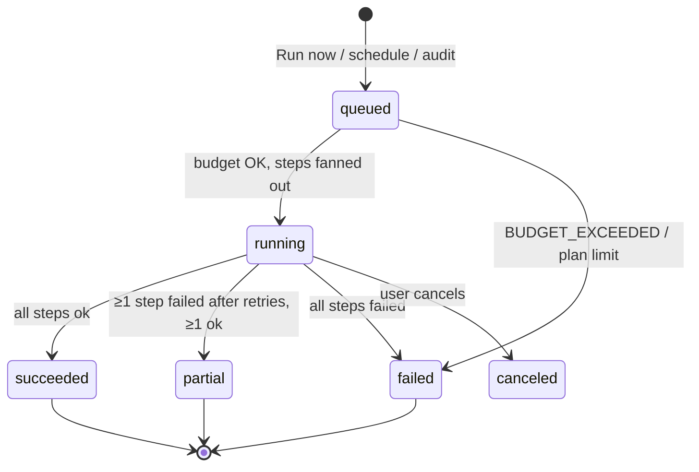

# 02 — App Flow

> **How to use this file:** Paste into a coding agent as the behavioral spec for routing, state transitions, and user journeys. Implement every route, state, and error path listed. When a step says "MUST", it is acceptance criteria.

## 1. Route map
| Route | Auth | Purpose |
|---|---|---|
| `/` | public | Landing + sample-report input |
| `/sample/[id]` | public | Live progress → report result |
| `/login`, `/signup` | public | Email magic link + Google |
| `/onboarding` | auth | 3-step setup |
| `/app` | auth | Dashboard |
| `/app/prompts` | auth | Prompt library |
| `/app/prompts/[id]` | auth | Prompt detail (answers per engine) |
| `/app/pages` | auth | All tracked pages, filter by owner/type |
| `/app/pages/[id]` | auth | Page history (citations over time, snapshots) |
| `/app/fixes` | auth | All fix reports, filter by state |
| `/app/fixes/[id]` | auth | Fix report |
| `/app/competitors` | auth | Domain management + head-to-head |
| `/app/runs` | auth | Run history + status + cost |
| `/app/settings` | auth | Workspace, billing, notifications |
| `/pricing` | public | Plans |
| `/api/sample` (POST), `/api/sample/[id]/stream` (SSE) | public, rate-limited | Sample job |
| `/api/stripe/webhook`, `/api/inngest` | system | Webhooks |

## 2. Journey F1 — Public sample report (acquisition engine)
1. Visitor lands on `/`, enters `acme.com` (accept `https://`, `www.`, paths → normalize to hostname).
2. Client-side validation (hostname regex). Turnstile token attached. POST `/api/sample`.
3. Server: validate, rate-limit (3/day/IP-hash), check cache (hostname < 7 d) → if hit, redirect to `/sample/[id]` immediately.
4. Else create `sample_reports` row (`running`), emit Inngest event, return `{id}`; client navigates to `/sample/[id]`.
5. `/sample/[id]` opens SSE; renders ordered steps as they arrive:
   `Reading your site → Found N pages (pricing P, docs D, comparison C) → Understanding your category → Writing 8 buyer questions → Asking ChatGPT… → Asking Perplexity… → Matching citations → Building report`.
6. Result view (MUST contain): matrix page-type × engine (own / competitor / third-party counts), **"Pages missing from AI answers"** list, top 3 competitor URLs with counts, one **teaser fix** (3 bullets), CTA "See the full fix report → create free workspace".
7. Errors: invalid domain → inline message; site unreachable → "We couldn't read this site (HTTP x). Try the root domain."; all engines fail → "Engines are busy, try again in a minute" (no charge to budget); partial → show what we have + banner.
8. Signup from this page MUST carry `sampleId` so onboarding pre-fills domain, prompts, competitors.

## 3. Journey F2 — Signup & onboarding (≤3 min)
`/signup` → magic link/Google → create `profiles`, `workspaces` (plan `free`), `workspace_members` → `/onboarding`.
- **Step 1 – Your domain:** hostname (prefilled from sample). Server runs `discover-pages` (async); show discovered counts live.
- **Step 2 – Competitors:** up to 5 (free plan: 2). Suggestions come from the sample report's `topCompetitorUrls` hosts / LLM `probableCompetitors`. User can add/remove.
- **Step 3 – Questions:** show 8–15 generated prompts grouped by intent with checkboxes + "add your own" + paste-many box. MUST enforce plan prompt limit with an inline counter.
- Finish → create `check_runs(trigger='onboarding')` for free-tier limits (≤8 prompts × 2 engines) → `/app?firstRun=1` with live run banner.

## 4. Journey F3 — Run lifecycle (state machine)

UI MUST show run progress (`completed/planned`, per-engine ticks), allow cancel, and never block navigation. After `succeeded|partial`, auto-generate fix reports for new lost prompts (cap per plan) and show a toast "N new lost prompts → fix reports ready".

## 5. Journey F4 — Daily use (dashboard)
1. `/app` loads summary for the last completed run vs previous: headline cards — **Own citation rate**, **Lost prompts**, **Verified wins**, **Next check in**.
2. Matrix block: rows = page types (/pricing, /docs, /comparison, other), columns = engines; cell = own% vs best competitor% (hover shows exact URLs). Click cell → filtered prompt list.
3. "Lost prompts" feed (sorted by intent weight: pricing > comparison > docs): prompt, engine chips, winner host+URL, CTA **Open fix report**.
4. Date range + engine + competitor filters persist in URL query.

## 6. Journey F5 — Prompt detail
`/app/prompts/[id]`: tabs per engine. Each tab: answer text with numbered citation markers, hover → URL card (own/competitor/third-party tag, page type). Right rail: ordered cited URL list with copy button; "retrieved but not cited" collapsed list (where available); history sparkline (cited? across last N runs); button **Generate / open fix report** (disabled with reason if own is already cited).

## 7. Journey F6 — Fix report
1. Open `/app/fixes/[id]`. Header: prompt, engine, run date, "Winner: host/path" vs "Your page: host/path | **No matching page**".
2. Section A **Why you lost (evidence):** side-by-side feature table (Winner | Yours | Δ) — only rows with differences highlighted first.
3. Section B **Fix checklist:** items sorted severity → effort; each shows evidence quote, recommendation, suggested copy (copy button), effort chip, checkbox.
4. Checking an item → `state='done'`, `marked_done_at` set, toast "We'll re-check on the next run". 
5. Footer: **Re-check now** (costs 1 prompt×engine call; allowed if plan quota) and disclaimer text from PRD §8.
6. Failure states: winner page unfetchable → report still builds from answer excerpt + features available, banner "Couldn't fetch competitor page (reason)"; LLM failure → deterministic items only + "Retry analysis".

## 8. Journey F7 — Verification loop
After each completed run, job `verify-fixes` evaluates reports with any `done` item: own page cited for same prompt+engine → `verified_win` (celebrate in digest + dashboard card); else `not_yet` (suggest next open items). Surface in `/app/fixes` with state filter.

## 9. Journey F8 — Weekly digest
Trigger: after scheduled run. Email: headline delta, top 3 losses with fix links, any verified wins, one "do this first" item. Unsubscribe link + settings toggle. Deep links include workspace token via magic link.

## 10. Journey F9 — Billing & limits
- Limits checked server-side on: add prompt, add competitor, run now, generate fix report, schedule cadence.
- Hitting a limit → modal with the exact limit, current plan, upgrade CTA; never silently drop.
- Upgrade: `/app/settings/billing` → Stripe Checkout → webhook sets `plan`, `run_cadence_hours`, budget cap → UI refresh. Downgrade: at period end; excess prompts become inactive (oldest kept active).
- **One-time audit:** `/pricing` "Buy audit $149" → Checkout → webhook creates `audit_purchases` → starts 3-sample run (40 prompts × 4 engines) → when done, deliver "Audit report" page + HTML export; credit $149 applied if subscription started within 30 d.

## 11. Edge cases (all MUST be handled)
Competitor equals own domain; duplicate prompts; prompt with brand name only; engine returns zero citations (show "No sources cited" — this is data, not an error); redirect chains; non-English pages; duplicate URLs via tracking params (normalize); user deletes a domain with history (keep rows, hide in UI); budget exhausted mid-run (remaining steps `skipped_budget`, run `partial`); provider key missing (engine disabled, UI hides chip with tooltip); stale cache; timezone (store UTC, display local).

## 12. Permissions
Owner: everything. Member: view all, edit prompts/domains, mark fixes; cannot change billing or delete workspace. (MVP ships with owner only; model supports members.)

## 13. Analytics events (PostHog or console shim)
`sample_started, sample_completed, sample_to_signup, onboarding_completed, run_started, run_completed, fix_opened, fix_item_done, fix_verified_win, upgrade_clicked, checkout_completed, audit_purchased, digest_opened`.
